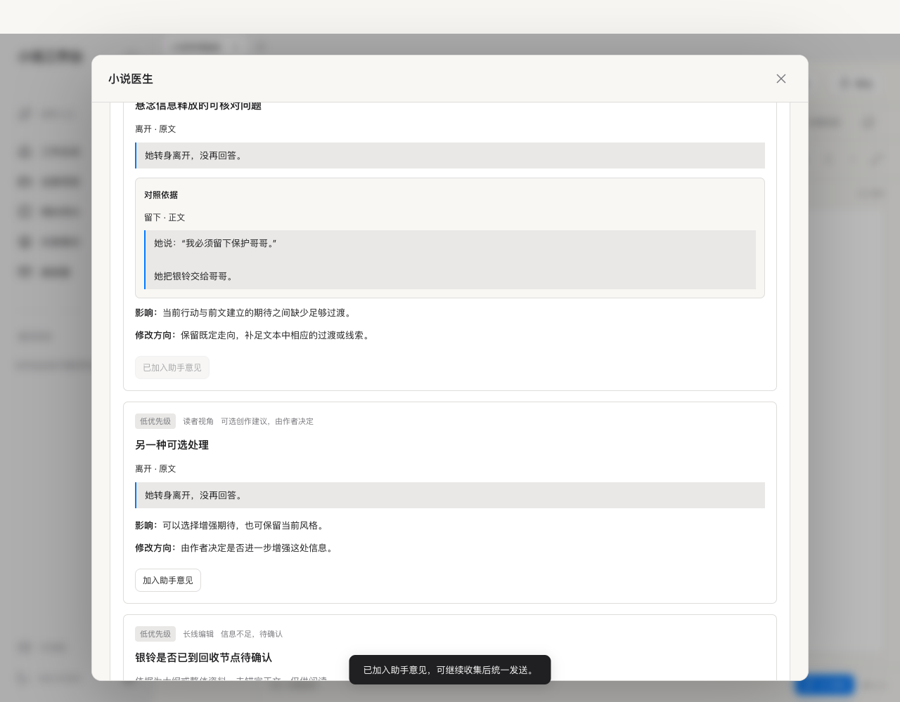

<p align="center"></p>

<p align="center">
<a href="https://github.com/giuliano1101/DSH-StoryDesk/releases/tag/v0.9.4"></a>
<a href="https://github.com/giuliano1101/DSH-StoryDesk/actions/workflows/ci.yml"></a>
<a href="LICENSE"></a>

</p>

<p align="center"><a href="README.md">简体中文</a> · <strong>English</strong> · <a href="README.ja.md">日本語</a></p>
<p align="center">A quieter space for bigger stories.</p>
<p align="center"><a href="https://github.com/giuliano1101/DSH-StoryDesk/releases/tag/v0.9.4">Download</a> · <a href="docs/installation.md">Installation</a> · <a href="CONTRIBUTING.md">Contribute</a></p>

## One desk. Many worlds.

**DSH StoryDesk** is a local-first novel and screenplay workspace for [DeepSeek Harness](https://github.com/deepseek-ai/deepseek-harness). Develop several projects, organize characters and world rules, outline chapters or episodes, write, consult an assistant, and recover earlier versions without leaving the desk.

| Workspace | What it offers |
| --- | --- |
| Projects | Separate novel and screenplay entry points, search, tasks, pins, archives and recoverable trash |
| Story foundations | Adopted characters, world rules and the complete outline form an inspectable Markdown story bible |
| Structure | Volumes and chapters for novels; episodes and scenes for serial screenplays |
| AI collaboration | On-demand popup, page-specific roles, personalities, imported Markdown Skills and actual Harness model selection |
| Revision | Exact-selection comments collected as collapsed attachments, one combined instruction, stale-source guards and pre-edit versions |
| Ownership | Local editing without AI; JSON backup, DOCX and print; novel Markdown / TXT and screenplay Fountain |

## Story doctors with traceable evidence

The screenplay and novel doctors offer general review, platform pacing, dialogue, continuity, character motivation, foreshadowing payoff, and suspense / information release. Review a chapter or scene, an applicable episode, or the material currently available for the whole work.

Reports consult the story bible, outline and bounded cross-section passages. They distinguish supported issues, optional craft suggestions and questions needing context. Diagnosis is read-only. Selected evidence-backed findings become collapsed assistant notes; rewriting begins only through the existing explicit send / revision flow.



*Actual interface with fictional acceptance-test content and a fixed test response, illustrating workflow rather than guaranteeing model quality.*

## Install in Harness

1. Download **`dsh-screenwriter-desk-0.9.4.tgz`** from [Releases](https://github.com/giuliano1101/DSH-StoryDesk/releases/tag/v0.9.4). Do not use the Source code archive as the plugin package.
2. Use Harness's plugin installation entry to install the local tarball / path.
3. Save your work, fully quit Harness (⌘Q on macOS), reopen it, and select **创作工作台** in the sidebar.

With an installed `dsh` CLI, target the profile you actually use; `desktop` is an example:

```sh
dsh plugin --profile desktop add ./dsh-screenwriter-desk-0.9.4.tgz
```

After this repository becomes public, the release URL can also be entered in Harness's Add plugin field:

```text
https://github.com/giuliano1101/DSH-StoryDesk/releases/download/v0.9.4/dsh-screenwriter-desk-0.9.4.tgz
```

**The repository is currently private.** Sign in to an authorized GitHub account and download locally first; Harness may not authenticate private asset URLs. Declared compatibility: Harness `>=0.2.1-rc.5 <0.3.0`, Node `>=20`. See the bilingual [installation guide](docs/installation.md) for checksums, migration and troubleshooting.

## Language, privacy and status

The application interface is currently **primarily Simplified Chinese**. Chinese, English and Japanese onboarding documentation is available; full UI localization is planned, not shipped. Ordinary writing and saving do not require AI. AI actions send the selected manuscript scope and relevant context to your configured provider. There is no built-in cloud account or automatic cross-device sync. See [security and privacy](SECURITY.md).

This is an early, actively evolving project. Version 0.9.4 was installed and tested in Harness with real model calls; see the [acceptance scope](docs/verification/0.9.4.md). Bounded context is disclosed; a whole-work diagnosis does not promise unlimited coverage.

[Contributing](CONTRIBUTING.md) · [Support](SUPPORT.md) · [Architecture](docs/architecture.md) · [Roadmap](docs/roadmap.md) · [Changelog](CHANGELOG.md)

## License and acknowledgments

[MIT](LICENSE), preserving existing copyright notices. Original writing-skill provenance and dependency licenses are documented in [THIRD_PARTY_NOTICES.md](THIRD_PARTY_NOTICES.md). Independent community project; not affiliated with or endorsed by DeepSeek.
