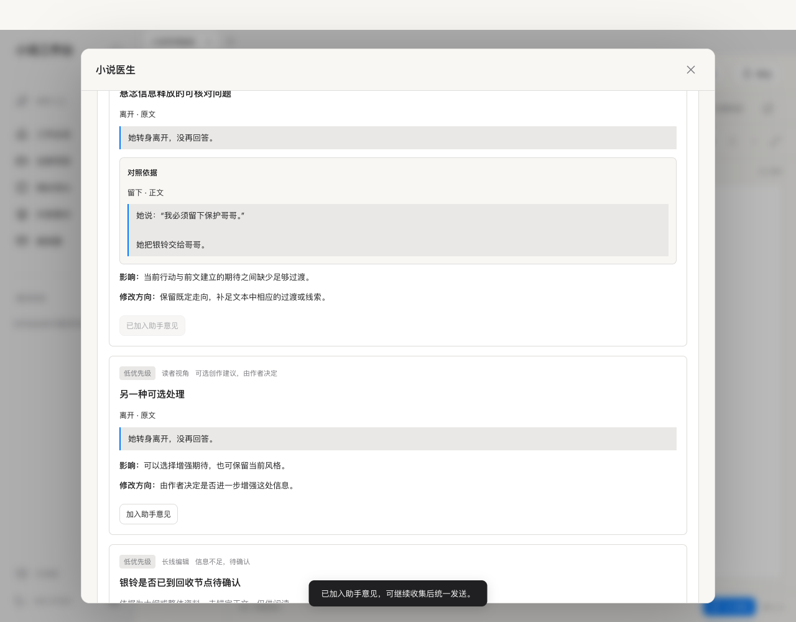

<p align="center"></p>

<p align="center">
<a href="https://github.com/giuliano1101/DSH-StoryDesk/releases/tag/v0.9.4"></a>
<a href="https://github.com/giuliano1101/DSH-StoryDesk/actions/workflows/ci.yml"></a>
<a href="LICENSE"></a>

</p>

<p align="center"><strong>简体中文</strong> · <a href="README.en.md">English</a> · <a href="README.ja.md">日本語</a></p>
<p align="center">把小说与剧本，从一个念头，写成一个完整世界。</p>
<p align="center"><a href="https://github.com/giuliano1101/DSH-StoryDesk/releases/tag/v0.9.4">下载安装包</a> · <a href="docs/installation.md">安装指南</a> · <a href="docs/user-guide.zh-CN.md">使用手册</a> · <a href="CONTRIBUTING.md">参与贡献</a></p>

## 为长期创作留出空间

**DSH StoryDesk** 是为 [DeepSeek Harness](https://github.com/deepseek-ai/deepseek-harness) 打造的小说与剧本创作工作台。多项目管理、故事设定、章节与分场、正文、上下文 AI 助手和版本恢复，在同一处衔接。写作与保存可以离线完成；需要 AI 时，使用你在 Harness 已连接的模型。

| 从构想到成稿 | 你可以做什么 |
| --- | --- |
| 多个作品，一张书桌 | 小说 / 剧本独立入口，跨项目搜索、待办、置顶、归档与可恢复的废纸篓 |
| 让设定成为依据 | 人物、世界观、采用状态与完整大纲生成可查看、导出的故事档案 |
| 按作品组织 | 小说按卷与章；电视剧、短剧按集与分场；保留各自写作术语 |
| 随时叫来搭档 | 浮动助手、页面角色、自定义性格、预设及导入 Markdown Skills、⌘Enter / Ctrl+Enter |
| 让修改有来有回 | 选段评论折叠收集，一次发送统一修改；检查原文变化并保留修改前版本 |
| 带着作品离开 | JSON 项目备份、Word、阅读打印；小说另有 Markdown / TXT，剧本支持 Fountain |

## 给故事做一次有依据的会诊

剧本医生与小说医生提供 **综合会诊、平台节奏、对白诊断、故事一致性、人物动机、伏笔回收、悬念信息释放**。支持当前章 / 场、适用的当前集，以及整部作品已有材料。

诊断对照故事档案、大纲和容量内的相关正文，展示引文、覆盖范围与判断依据。把有依据的问题、可选建议和需要作者补充的信息分开。**诊断不直接改稿**：选定意见进入助手，确认发送后才进入已有改写流程。

<p align="center"></p>
<p align="center"><sub>实际界面，使用虚构验收样本与固定测试响应展示证据和意见移交；不是模型质量承诺。</sub></p>

## 安装到 Harness

**推荐下载预构建安装包，不需要编译源码。**

1. 打开 [v0.9.4 发布页](https://github.com/giuliano1101/DSH-StoryDesk/releases/tag/v0.9.4)，下载 `dsh-screenwriter-desk-0.9.4.tgz`。
2. 在 Harness 的插件安装入口选择本地安装包 / 路径，或按安装对话框支持的方式填写安装包地址。
3. 保存工作，完整退出 Harness（macOS：⌘Q）后重新打开，从侧栏进入「创作工作台」。

已安装 `dsh` CLI 的用户也可安装到自己实际使用的 profile。例如桌面 profile：

```sh
dsh plugin --profile desktop add ./dsh-screenwriter-desk-0.9.4.tgz
```

**地址安装方式**：在 Harness「添加插件」粘贴下方完整地址，或作为 `dsh plugin ... add` 的参数：

```text
https://github.com/giuliano1101/DSH-StoryDesk/releases/download/v0.9.4/dsh-screenwriter-desk-0.9.4.tgz
```

仓库已公开，可直接下载安装包，无需登录 GitHub。兼容声明为 Harness `>=0.2.1-rc.5 <0.3.0`、Node `>=20`；不要据此推断所有未来版本都兼容。详见 [安装、校验与迁移](docs/installation.md)。

## 你的稿件，你的决定

稿件和设置保存在本机；工作台没有账户云同步服务。AI 请求会把所选范围内的作品内容和相关上下文发送给你配置的模型服务。请自行评估服务方的数据政策；离线编辑无需模型。模型密钥不进入项目备份，安装包不含作者作品。[隐私与安全边界](SECURITY.md)

界面目前以**简体中文**为主；仓库提供中文、英文和日文上手文档。完整界面国际化尚未完成，欢迎参与。独立服务器和前端均可本地运行，见 [贡献指南](CONTRIBUTING.md)。

## 项目状态与参与

当前是快速迭代的早期项目。0.9.4 已完成实际 Harness 安装及真实模型诊断验收；范围与限制见 [验收说明](docs/verification/0.9.4.md)。没有承诺多人协作、自动跨设备同步或全书无限上下文检查。

[报告问题](https://github.com/giuliano1101/DSH-StoryDesk/issues/new/choose) · [获取帮助](SUPPORT.md) · [开发结构](docs/architecture.md) · [路线图](docs/roadmap.md) · [更新记录](CHANGELOG.md)

## 许可与致谢

采用 [MIT License](LICENSE)，保留原有版权声明。原创剧本创作技能的来源、授权及依赖许可见 [第三方与来源说明](THIRD_PARTY_NOTICES.md)。本项目是独立社区项目，与 DeepSeek 无官方隶属关系或背书关系。[开源准备清单](docs/open-source-checklist.md)
